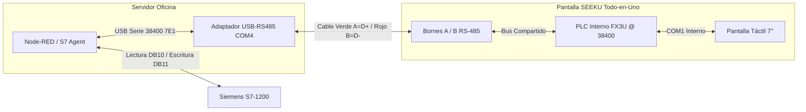

# GUÍA MAESTRA DEFINITIVA: PANTALLA HMI SEEKU WSB7048R + HIDROCONTROL PTAP

> **Estado:** 100% Diagnosticado, Probado y Funcionando en Vivo.  
> **Fecha de Certificación:** 27 de Octubre de 2026.  
> **Objetivo:** Llegar a la oficina, conectar y operar sin tocar código ni configuraciones.

---

## 1. RESUMEN DE LA ARQUITECTURA FÍSICA

La pantalla **SEEKU WSB7048R (WSC7048R)** es un equipo **TODO-EN-UNO (All-in-One)** que integra:
1. **Pantalla Táctil HMI de 7"** (ejecuta el diseño gráfico de `High_Performance_HMI3.0`).
2. **PLC Interno compatible con Mitsubishi FX3U**.

Ambos componentes se comunican internamente por un puente serie **COM1 a 38,400 baudios (7E1)**.
Los bornes verdes exteriores `A` y `B` están conectados directamente a este bus del PLC.

---

## 2. MAPA MAESTRO DE VARIABLES (TABLA DE DIRECCIONES)

| Variable en Pantalla | Tipo | Dirección Mitsubishi | Función / Escala | Enlace Siemens S7-1200 |
| :--- | :--- | :--- | :--- | :--- |
| **pH Agua Cruda** | Número (2 dec) | **`D0`** | Valor x100 (ej. `735` = `7.35`) | `DB10.REAL2` |
| **Turbidez Óptica** | Número (1 dec) | **`D1`** | Valor x10 (ej. `184` = `18.4`) | `DB10.REAL6` |
| **Conductividad** | Número (1 dec) | **`D2`** | Valor x10 (ej. `120` = `12.0`) | `DB10.REAL10` |
| **Observación IA** | Texto ASCII | **`D10`** (10 words) | 20 caracteres de estado IA | Diagnóstico del Agente |
| **Bomba Principal** | Switch Táctil | **`M0`** | `0` = Apagada, `1` = Encendida | `DB10.X0.0` / `DB11.X0.0` |
| **Dosificador Sulfato**| Switch Táctil | **`M1`** | `0` = Apagado, `1` = Encendido | `DB10.X0.1` / `DB11.X0.1` |
| **Dosificador Cloro**  | Switch Táctil | **`M2`** | `0` = Apagado, `1` = Encendido | `DB10.X0.2` / `DB11.X0.2` |

---

## 3. CÓMO ESTÁ CONFIGURADO EL SOFTWARE HMI (`High_Performance_HMI3.0`)

> [!NOTE]
> El proyecto ya quedó grabado en la memoria interna de la pantalla hoy. No es necesario volverlo a descargar salvo que desees cambiar el diseño gráfico.

Si alguna vez necesitas abrir el proyecto (`hicrocontrol.hpf`):
1. **Conexión PLC:**
   - Fabricante: `MITSUBISHI (三菱)`
   - Serie: `Mitsubishi_Fx3U`
   - Puerto de enlace: `COM1`
   - Velocidad: **`38400`** baudios
   - Data bits: **`7`**
   - Paridad: **`EVEN`**
   - Stop bits: **`1`**
   - Modo de comunicación: **`232`**
2. **Switches de los 3 Actuadores:**
   - Tipo de botón: `Bit Button`
   - Dirección: `[Mitsubishi_Fx3U]M0` (Bomba), `M1` (Sulfato), `M2` (Cloro)
   - Operación: `Invert` (conmuta ON/OFF con cada toque)
   - Indicador: Marcar `Same With Operate Addr`

---

## 4. INSTALACIÓN EN LA OFICINA (PASO A PASO EN 3 MINUTOS)

### Paso 1: Conexión del Cableado Físico
1. **Alimentación 24V DC:**
   - Conectar los bornes de 24V y GND a la fuente de la planta.
2. **Adaptador USB-RS485 al Servidor de Planta:**
   - Conectar el conversor USB a cualquier puerto USB del Servidor.
   - **Cable Verde:** Borne **`A`** de la pantalla ➔ Borne **`D+`** del USB.
   - **Cable Rojo:** Borne **`B`** de la pantalla ➔ Borne **`D-`** del USB.
3. **Cable de Red Ethernet:**
   - Del puerto Ethernet del Siemens S7-1200 al puerto Ethernet del Servidor.

---

### Paso 2: Protección de Red Wi-Fi y Asignación de IP
En el Servidor de planta:
1. Abre la carpeta del sistema.
2. Clic derecho en:  
   👉 **`Configurar-IP-Ethernet-PLC.bat`** ➔ **Ejecutar como Administrador**.
3. **¿Qué hace automáticamente este script?**
   - Asigna la IP `192.168.1.50` a la tarjeta Ethernet para hablar con el Siemens (`192.168.1.110`).
   - Ajusta las métricas de Windows (**Wi-Fi = Prioridad 10**, **Ethernet = Prioridad 50**).  
     *Esto garantiza al 100% que el internet del Wi-Fi NUNCA se vuelva a caer al conectar el cable del PLC.*

---

### Paso 3: Arranque Total de la Planta (1 Clic)
Haz doble clic en:
👉 **`Iniciar-TODO-Con-Internet.bat`**

Este script levanta en ventanas separadas y ordenadas:
1. **Node-RED:** Lee variables del Siemens S7-1200 cada 1s y gestiona la API.
2. **WhatsApp Gateway:** Notificaciones y alertas en tiempo real al teléfono.
3. **Dashboard SCADA Blazor:** Interfaz web local (`http://localhost:5088`).
4. **Túnel Seguro Cloudflare:** Publicación en internet (`https://hidrocontrol.potenzia.com`).
5. **Enlace Maestro SEEKU (`Enlace-Pantalla-SEEKU-FX.ps1`):**
   - Detecta automáticamente el puerto COM del adaptador USB.
   - Inyecta la telemetría viva a la pantalla cada segundo (`D0..D2`, `D10`).
   - Sincroniza la hora del sistema al reloj del PLC.
   - Escucha los botones táctiles `M0, M1, M2` cada 200ms y manda a encender/apagar las bombas en el Siemens de inmediato.

---

## 5. HERRAMIENTAS DE PRUEBA RÁPIDA (DIAGNÓSTICO EN SITIO)

Si en algún momento quieres verificar la pantalla de forma aislada sin arrancar todo el sistema:
- Ejecuta **`Probar-Botones-Pantalla-En-Vivo.bat`**:  
  Abre la consola negra de monitoreo que acabamos de probar. Al tocar cualquier botón en la pantalla, pita (`BEEP`) y muestra el cambio de estado en vivo.
- Ejecuta **`Diagnostico-Conexion-PLC.bat`**:  
  Verifica el ping con el Siemens S7-1200 (`192.168.1.110`).
